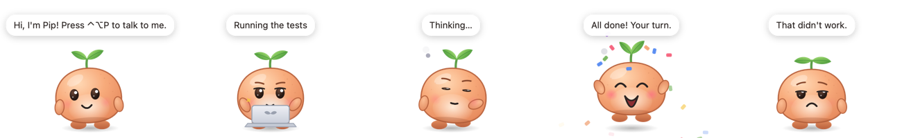

# Pip

A little sprout-headed creature that lives on your Mac desktop. Pip floats above your windows, keeps an eye on your Claude Code sessions, has moods, reacts when you pat it or carry it around, and talks back when you talk to it.

<p align="center"></p>

Pip isn't a drawing: it's a small 3D creature rendered live on your Mac, with fuzzy peach skin, wet eyes with real eyelids, a damp nose, a leafy sprout that sways, and a soft shadow underneath.



## What Pip does

- **Lives on top of everything.** Pip floats above every app and on every Space. Clicks around it go straight through to the windows underneath.
- **Looks alive.** Pip is a small 3D creature rendered live, not a drawing: fuzzy peach skin, wet eyes with real eyelids, a damp nose, a leafy sprout, real light and a soft shadow.
- **Has feelings.** Springs and physics move its body, eyes, lids, mouth, arms and leaves through 16 emotions, from happy and curious to bored, sleepy and sad.
- **Gets up to things.** Left alone, Pip looks around, sniffs, hops, stretches, yawns and eventually falls asleep.
- **Notices you.** Its eyes follow your pointer, and hovering makes it blush. Click to pat it (three quick pats make it hop); drag it and it dangles, then lands with a puff of dust.
- **Talks.** Press **⌃⌥P** (Control-Option-P) anywhere and speak. Pip listens, then answers in its speech bubble and out loud in a small, high pet voice.
- **Does things for you.** Pip can read files, run commands and use your connected services, like Jira, Confluence or email. It always asks first before running a command, changing a file or sending anything.
- **Watches your Claude Code sessions and chats.** Pip sees every Claude Code session on your Mac and, if you sign it in, your Claude app chats too. It shows the busy one and can tell you what any of them is doing.

## Install

You need macOS 13 or later and Apple's Command Line Tools, which provide the Swift compiler:

```bash
xcode-select --install
```

Then build and open Pip:

```bash
git clone https://github.com/muradinfosec/pip-desktop-pet.git
cd pip-desktop-pet
./install.sh
```

That builds `Pip.app` into `~/Applications` on your own Mac and opens it. Pip adds itself to **Login Items** the first time it runs, so it's there every time you log in.

### Talking to Pip

Pip answers through the [Claude Code](https://claude.com/claude-code) command-line tool, using your own Claude login (no API key). It gets Claude Code's tools and your claude.ai connectors. Install it and sign in once:

```bash
claude auth login
```

The first time you press ⌃⌥P, macOS asks to let Pip use the microphone and speech recognition.

Pip uses Apple's speech recognition, the same as Mac dictation, which sends your voice to Apple for the most accurate result. To keep your voice on your Mac instead (a little less accurate), turn on **Dictation → Keep My Voice on This Mac** in Pip's menu. The same menu picks the language Pip listens in; by default it's your Mac's.

## What Pip may do

**Computer Access** in Pip's menu sets how much it can do:

| Setting | Pip can |
|---|---|
| Just Chat | Only talk. No files, commands or connectors. |
| Read Files Only | Read files, search, and look things up in connected services. |
| Do Things, Ask Me First (default) | Also run commands, change files and act through connectors, but only after you say yes. |

When Pip wants to do something, its bubble shows exactly what (the command, the file, or the email or Jira change) with **Allow** and **Deny** buttons, and Pip asks out loud. Click a button, or press ⌃⌥P and say "yes" or "no". Anything you don't answer within two minutes is denied, and **Stop What Pip Is Doing** in the menu cancels a task.

Connectors are the ones on your claude.ai account. A connector that shows as needing authorization has to be reconnected in your claude.ai connector settings first.

## Watching your Claude Code sessions

Pip watches every Claude Code session on your Mac, in the terminal and in the Claude desktop app, all the time and with no setup. It follows each session's conversation in `~/.claude/projects/` as it's written and uses the desktop app's session titles. Pip then:

- shows the busiest session, with its name in the bubble when several are working,
- tells you when another session finishes or needs you, including background commands and helpers it's still waiting on,
- lists every session from the last 12 hours, and what each is doing, in the menu,
- can read a session's history when you ask what it's doing.

For one more signal, turn on **Watch All Claude Sessions** in Pip's menu: it adds a small hook to `~/.claude/settings.json` (keeping a backup at `~/.claude/settings.json.pip-backup`) so Pip also knows when a session is waiting for your approval. Turning it off removes the hook.

When several sessions are busy, Pip shows the session's name in a small caption above its line. To keep a session's name out of the bubble, list it by title or project folder:

```bash
defaults write local.pip-pet.desktop quietNames -array "My session title"
```

To see what Pip sees, run:

```bash
~/Applications/Pip.app/Contents/MacOS/Pip --list-sessions
```

## Watching your Claude app chats

Chats in the Claude app's Chat tab answer on claude.ai and leave nothing on your Mac, so Pip asks claude.ai about them. Turn on **Watch Claude App Chats** in Pip's menu and sign in to Claude in the small window Pip opens, the same way you would in a browser. You only do this once.

Pip then checks your recent chats every few seconds, whatever the Claude app is showing, and treats them like sessions: it shows a chat while Claude is answering (searching the web, researching, thinking or writing), tells you when it finishes, and lists it in the menu next to your Claude Code sessions.

Your sign-in stays in Pip's own web storage, like a browser's. Pip's code never reads or copies it, and Pip talks only to claude.ai. claude.ai doesn't document the way Pip asks about chats, so a change on its side can break this until Pip is updated. Turn the switch off to stop.

## Using Pip

- **Move:** drag Pip anywhere, right up to the menu bar. It remembers the spot.
- **Pat:** click Pip.
- **Talk:** press ⌃⌥P, speak, then pause. Press ⌃⌥P again to stop early.
- **Read:** long answers stay up long enough to read, and stay while your pointer rests on Pip. **Show Last Answer** in the menu brings back the last one.
- **Menu:** right-click Pip, or click the Pip icon in the menu bar, for:
  - Show or hide Pip
  - Move Pip to the corner, for when it's lost off-screen
  - Talk to Pip and Pat Pip
  - Speak Answers, Pet Voice and Open at Login switches
  - Computer Access, Dictation, Watch All Claude Sessions and Watch Claude App Chats
  - Your Claude Code sessions and chats, and what each is doing
  - Quit Pip

## Telling Pip what you're doing (optional)

Pip watches `~/.claude/pip-pet/status.json`. Anything can write it (a script, a hook, an editor plugin), and Pip acts out what it says:

```json
{ "mood": "working", "activity": "read", "line": "Reading notes.md", "updatedAt": 1731600000000 }
```

| `mood` | What Pip does |
|---|---|
| `thinking` | Hand on chin, thought dots |
| `working` | Busy; `activity` picks a prop: `run`, `edit` or `write` (laptop), `read` (book), `search` or `web` (magnifying glass), `helper` (paper plane) |
| `waiting` | Waves with a "?" |
| `done` | Jumps with confetti, then idles |
| `oops` | Flinches, then looks sad |
| `sleeping` | Falls asleep |

`line` is what Pip says in its bubble.

## Uninstall

If you turned on **Watch All Claude Sessions**, turn it off first. Then right-click Pip, choose **Quit Pip**, and run:

```bash
rm -rf ~/Applications/Pip.app ~/.claude/pip-pet
```

If you signed Pip in to Claude for chats, this also removes that sign-in:

```bash
rm -rf ~/Library/WebKit/local.pip-pet.desktop ~/Library/Caches/local.pip-pet.desktop
```

If Pip is still listed in System Settings → General → Login Items, remove it there.

## License

[MIT](LICENSE)
